# CLI architecture

This document describes the code in the repository root. The frontend and backend templates are separate applications with their own architecture and documentation.

## Runtime path

```mermaid
flowchart LR
    A[CLI arguments] --> B[parseCliArgs]
    B --> C[resolveConfig]
    C --> D[scaffoldProject]
    D --> E[Copy selected template]
    E --> F[Rename backend app directory]
    F --> G[Replace text placeholders]
    G --> H[Optional Git initialization]
    H --> I[Optional dependency install]
    I --> J[Optional dependency upgrade]
    J --> K[Print next steps]
```

`src/index.ts` coordinates this sequence. It uses `@clack/prompts` for progress and `picocolors` for terminal output. The actual file operations are in `src/scaffold.ts`; external commands are in `src/post.ts`.

### 1. Parse arguments

`src/cli.ts` defines the command with `cac`. It extracts the optional project name and recognized flags. The parser only assigns `type` when it is `fe` or `be`, and only assigns a package manager when it is one of `pnpm`, `npm`, `yarn`, or `bun`. `--help` and `--version` exit during parsing. `src/prompts.ts` resolves any values still missing.

### 2. Resolve a configuration

`src/prompts.ts` chooses the project type, name, directory, package manager, and optional operations. `src/validate.ts` checks package-name format and derives the sanitized name used for the default directory and backend application folder.

The destination is resolved against the process working directory, unless an absolute path was supplied. A dot (`.`) means the current directory. The CLI checks whether the destination already contains files before scaffolding. Interactive users can cancel, overwrite, or merge; noninteractive users must supply `--overwrite` for a nonempty destination.

The resolved configuration is typed by `ResolvedConfig` in `src/types.ts`. Keep the parser, prompt defaults, and documentation aligned when adding a flag. In particular, `--yes` defaults to frontend, enables Git and installation, and enables dependency upgrades when installation is enabled.

### 3. Copy and specialize the template

`src/scaffold.ts` resolves `templates/fe` or `templates/be` relative to the CLI bundle/source. It copies files with `fs-extra`, excluding `node_modules`, `.git`, `.next`, `dist`, and legacy `template-shims.d.ts` files. It restores `_gitignore` and `_npmrc` to `.gitignore` and `.npmrc` in the generated root.

The source templates' root `tsconfig.json` files contain `compilerOptions.noCheck: true` for editor use in this repository. Immediately after copying, `copyTemplateFiles` removes that flag from the destination. For the backend it also restores `compilerOptions.types` to `["multer"]`. This is required because the source template has no installed `@types/multer`, while a generated backend must check against that package after installation.

For the backend, `handleBackendMonorepoAppDir` renames `apps/__projectName__` to the sanitized project name. The rename precedes text replacement because the app folder itself uses a sentinel name rather than a `{{...}}` text placeholder.

`replaceAllPlaceholders` then walks the generated tree. `src/placeholders.ts` skips known binary extensions and files containing a null byte near the start, decodes other files as UTF-8, and replaces the four known placeholders. It does not rename arbitrary paths containing placeholders. Docker/YAML files receive a sanitized replacement for `{{projectName}}` where a raw scoped package name would be invalid.

| Derived value | Implementation | Typical use |
| --- | --- | --- |
| `projectName` | Input after validation | `package.json` name |
| `sanitizedProjectName` | Last path segment, non-name characters replaced with `-` | Nest application directory, Docker names |
| `projectNameTitle` | Scope removed, `_`/`-` words title-cased | Human-readable UI/API labels |
| `projectNameDb` | Scope marker removed, `/`, `.`, and `-` replaced with `_` | Database name in environment/Compose files |

If a newly created destination fails during scaffolding, `scaffoldProject` attempts to remove it. An existing destination is not rolled back: in merge mode, files already copied or replaced can remain after an error; in overwrite mode, the previous contents have already been cleared. That distinction matters when changing failure handling or documenting safety.

### 4. Optional post-scaffold actions

`src/post.ts` runs Git commands and package manager commands with `execa`. Git initialization and the initial commit are best-effort: a commit failure, such as missing Git identity, returns an initialized repository without a commit.

Installation uses the selected package manager's `install` command and sets `HUSKY=0` in the child environment. Dependency upgrade uses `pnpm up --latest`, `bun update`, `yarn up`, or `npx npm-check-updates -u` followed by `npm install`. Before upgrading, it reads `package.json`. On upgrade failure, it restores that file and retries a normal install. The fallback is scoped to `package.json`; it is not a full transactional rollback of every lockfile or installed package.

`printNextSteps` displays commands for the chosen template and package manager. A generated project's scripts live in its template `package.json`, not in the root package.

## Source boundaries

| Area | Owns | Does not own |
| --- | --- | --- |
| Root `src/` | CLI behavior and filesystem/post-scaffold flow | FE/BE application runtime |
| Root `tests/` | CLI unit and end-to-end behavior, plus safe template-import helper tests | Complete FE/BE application test suites |
| `templates/fe/` | Files copied into a Next.js project | Root CLI build configuration |
| `templates/be/` | Files copied into a NestJS monorepo | Root CLI build configuration |
| `scripts/prepare-templates.mjs` | Importing and sanitizing two local upstream repositories | The normal end-user scaffold flow |

The root `tsconfig.json` includes only `src/`; root ESLint targets `src/` and `tests/`. Each template has its own configuration. Do not treat a root typecheck as validation of a generated application.

## Where to change behavior

- New CLI flag or default: `src/cli.ts`, `src/prompts.ts`, `src/types.ts`, and relevant docs/tests.
- Project name or destination rules: `src/validate.ts` and `src/placeholders.ts` as appropriate.
- Copy, exclude, rename, or generated TypeScript settings: `src/scaffold.ts`; keep `scripts/prepare-templates.mjs` and template configs consistent.
- Package manager or upgrade behavior: `src/pm.ts` and `src/post.ts`.
- Template application code: the relevant `templates/fe` or `templates/be` subtree; consult that template's own agent and architecture documents.
- Upstream template refresh: `scripts/prepare-templates.mjs` and [Template maintenance](template-maintenance.md).
